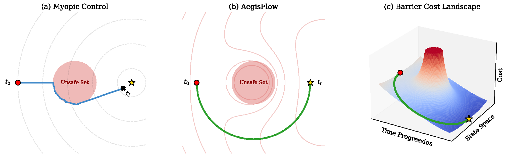

# AegisFlow

<div align="center">
 


</div>

### AegisFlow: Training-free Non-myopic Path-safe Guided Flow Matching

*Kunpeng Liu, Boshi Zhang, Keyou You†*

† Corresponding author.

In this paper, we propose AegisFlow, a training-free, non-myopic path-safe guidance framework that recasts guided generation as a safety-critical optimal control problem with global scope. By integrating a time-varying barrier function directly into the global cost functional, AegisFlow naturally enforces constraints along the entire generative path. To compute the global optimal control, we derive a tractable, mathematically grounded approximation of the Hamilton-Jacobi-Bellman (HJB) equation.

<p align="center">
  
</p>

This branch (`image`) reproduces the text-guided image editing experiments from the paper.

**Nota Bene:** We re‑implement all methods ([OC-FLow](https://github.com/WangLuran/Guided-Flow-Matching-with-Optimal-Control), [HardFlow](https://github.com/azizanlab/HardFlow/tree/image) and AegisFlow) using a common protocol: optimize CLIP + LPIPS and enforce the same ID constraint (>0.825, for HardFlow and AegisFlow). To recover the results reported in the paper, you may modify the objective function to be CLIP-only.

---

### Installation

```bash
conda env create -f environment.yml
conda activate aegisflow_image
pip install -r requirements.txt
```

Place the images to be edited under `./experiment/`.

---

### Dataset and Model Weights

- The CelebA-HQ dataset can be downloaded from [kaggle celeba-hq dataset](https://www.kaggle.com/datasets/lamsimon/celebahq).

- The pre-trained rectified-flow model can be downloaded from [Rectified Flow CelebA-HQ](https://drive.google.com/file/d/1ryhuJGz75S35GEdWDLiq4XFrsbwPdHnF/view?usp=sharing). Please modify the path in `./main.py` accordingly.

- The ArcFace weight is `model_ir_se50.pth` from [InsightFace](https://github.com/TreB1eN/InsightFace_Pytorch). Please clone that repo and download that weight, and modify the corresponding path in `./utils/methods.py`.

---

### Evaluation

```bash
python main.py --folder experiment --method aegisflow
```

The results can be found in `./output`. To see the statistics of the result, run `python summarize_metrics.py`.

---

### Acknowledgement

- The text-guided image manipulation implementation is based on [OC-Flow](https://github.com/WangLuran/Guided-Flow-Matching-with-Optimal-Control) and [HardFlow](https://github.com/azizanlab/HardFlow/tree/image).

- The Arcface implementation is directly from [InsightFace](https://github.com/TreB1eN/InsightFace_Pytorch).